<div align="center">


# Victorious Keyboard

**An open-source Android keyboard for everyday typing, developers, and terminal users — with a clipboard manager, snippets, and offline tools.**

[](LICENSE)
[](https://kotlinlang.org)
[](https://developer.android.com/compose)
-3DDC84?logo=android&logoColor=white)
[](https://github.com/florisboard/florisboard)


[Overview](#overview) · [Features](#features) · [Screenshots](#screenshots) · [Status](#status) · [Build](#build-and-install) · [Contributing](#contributing) · [Licence](#licence)

</div>

> [!WARNING]
> **Early development.** The core logic of the Victorious additions is unit-tested on the JVM. The Android screens and
> wiring compile, but **none of the additions has been run on an Android device yet.** Do not use this as your only
> keyboard. Details: [Status](#status).

## Overview

Victorious Keyboard is a modified distribution of [FlorisBoard](https://github.com/florisboard/florisboard)
(Apache-2.0, based on upstream tag `v0.6.0-alpha02`). It keeps FlorisBoard's typing engine and layouts. The default look is Victorious Black: a near-black background, charcoal keys, light legends, and a small corner radius. Victorious Neon stays in the theme list and in the color presets. The older FlorisBoard themes stay selectable. Settings Home is grouped under Look, Typing, Tools, Developer, Data, and About, and every entry has a one-line summary. It adds:

* **Keyboard colors** — Settings → Look → Keyboard colors. Background, key, key text, accent, highlight, and suggestion pills, with presets and a reset. The choice is saved and painted over Victorious Neon.
* **Word prediction** — current word, next word, and a close correction from the bundled dictionaries. A word that is already in the dictionary, your dictionary, or learned words is never replaced. Autocorrect is Off, Mild, or Normal. *Learn from my typing* is off until you turn it on.
* **Clipboard manager** — up to 500 items with search, pinning (pinned items are kept), filters, and AES-256-GCM encrypted storage (Android Keystore–wrapped key). A separate **Vault** tab holds sensitive clips.
* **Terminal key row and operating modes** — Settings → Developer & terminal. Esc, Tab, Ctrl, Alt and arrows, shown automatically in terminal apps and in Developer or Termux mode (or Always / Never); Standard / Developer / Termux modes with optional auto-detect for Termux and ConnectBot.
* **Snippets** — reusable text with templates (`{{selection}}`, `{{clipboard}}`, date/time), an in-keyboard picker, and optional expansion on Space (Enter and Tab can be turned on separately).
* **Dictionary packs** — five bundled word lists for technical vocabulary (install/remove on your choice).

It is not affiliated with or endorsed by the FlorisBoard project. The repository retains upstream's full Git history so per-file authorship is preserved. Design goal: **nothing leaves the device** — no analytics, no ads, and no `INTERNET` permission.

## Features

Status key: ✅ **tested** (JVM unit tests) · 🟦 **built, not run** on a device · 🔹 **inherited** from FlorisBoard · ⬜ **planned**

### Look

Settings → Look holds Languages, Theme, Keyboard colors, and Keyboard.

Victorious Black is the default day and night theme. Victorious Neon and Neon Light stay selectable. Keys are rounded and spaced. This has been compiled and drawn from the stylesheet. It has not been shown on a device.

Bottom gap (Settings → Look → Keyboard) lifts the docked keyboard above the navigation bar and the home-gesture strip. The padding is the largest of the navigation-bar, mandatory system-gesture, tappable-element, and IME caption-bar insets. A slider from 0 to 48 dp adds more space; it starts at 16 dp on gesture navigation and 4 dp with 3-button navigation, and the strip is the keyboard background. The keyboard preview on that screen is the real keyboard, so the gap shows there. A touch that starts on a key and slides into the system strip does not insert the character. This is compiled and unit-tested. It has not been run on a device.

Keyboard colors (Settings → Look → Keyboard colors) let you recolor that Neon theme without the Snygg theme editor. You can set the background, key color, key text, accent and glow, highlight (space bar and emphasis), and suggestion pills. A hue and saturation wheel plus a hex field edits one color at a time, and the keyboard preview on the screen updates immediately. Presets: Neon, Cyber blue, Matrix, Purple, Red, and Mono. Reset to default restores Neon. Text that would be hard to read is replaced with a dark or light ink. The choice is stored in preferences and applied again on the next start, including popups, the clipboard strip, the developer row, and the emoji panel. It applies while Victorious Neon or Neon Light is the selected keyboard theme. Another theme is left alone. The screen is compiled and not yet run on a device.

### Typing (inherited)

QWERTY, numeric and symbol layouts, emoji, long-press, key repeat, haptics, sounds, themes, one-handed mode, number row, shift/caps — 🔹. Physical keyboard support is incomplete upstream. Glide typing has a classifier but needs a dictionary and is unverified. Floating/split keyboard is planned.

### Clipboard manager

| Feature | Status |
|---|---|
| 500-item history; pinned items never evicted | ✅ policy · 🟦 wired |
| Encrypted at rest (AES-256-GCM, Keystore-wrapped) | ✅ cipher · 🟦 Room/Keystore |
| Search, filters, tags, favourites, edit, multi-select, share | ✅ logic · 🟦 screens |
| Password / API-key / card-looking text not saved to the regular clipboard by default | ✅ |
| Sensitive vault (separate store, masked, expiry, lock) | ✅ rules · 🟦 screen and Keystore |
| Copy in a password field, or a clip Android marks sensitive, goes to the vault | ✅ routing · 🟦 call site |
| Export/import: JSON, ZIP, encrypted archive, Markdown, text. Vault only in an encrypted export you opt into | ✅ logic · 🟦 file pickers |
| ZIP export/import of Regular, Vault, or both. Vault requires a password. Merge or replace on import | ✅ logic · 🟦 file picker |
| Images/URI clips in backups | ⛔ skipped (cannot restore safely) |

The keyboard clipboard panel has two tabs, **Clipboard** and **Vault**, using the same neon theme. Password-field copies and clips Android flags as sensitive go to the Vault when clipboard history is on. *Detect secrets into the vault* (Settings → Tools → Clipboard) is off until you turn it on; it looks for card numbers, IBANs, API keys, private keys, and one-time codes. You can move an item between the two lists. Vault text is encrypted with its own Android Keystore key, kept out of the suggestion bar, and masked until you reveal it. Viewing it asks for the device lock (on by default) and locks again after a timeout. Unpinned vault items expire after 24 hours unless you pick another period or Never; pins stay. Vault items are not in the older backup formats unless you opt into an encrypted export. Settings → Tools → Clipboard also has **Export to ZIP** and **Import from ZIP**. You choose Regular, Vault, or both. A Regular ZIP can be plain, with an optional password. A ZIP that includes the vault must be password-encrypted (the same AES-256-GCM container, stored inside the ZIP) and the screen says so. Import checks the file, asks for the password when there is one, and can merge or replace; vault rows go back to the vault. Images are still skipped. The regular history cap, pins, and search are unchanged. None of this has been run on a device.

Details: [CLIPBOARD.md](CLIPBOARD.md), [BACKUP_FORMAT.md](BACKUP_FORMAT.md).

### Suggestion strip and tools

While you type, the top strip shows word suggestions only. It scrolls sideways when there are more candidates than fit, and the primary suggestion is underlined. When you are not typing, a recent clipboard chip can still appear. A single tools button on the left opens the **tools panel** in place of the keys. It has five tabs: **Clipboard** (history, paste, copy, cut, select all, undo, redo, snippets, clip editor, paste pinned, vault, ZIP backup), **AI**, **Terminal** (Ctrl, Alt, Esc, Tab, arrows, Home, End, PgUp, PgDn, ^C ^D ^Z ^L ^R, the key-row setting, and your own commands), **Code**, and **Quick** (incognito, learning, emoji, voice, one-handed, bottom gap, colors, settings, screenshot). Each button is an icon with a translatable label; switches such as Incognito show On or Off. The panel is drawn with the keyboard theme's own tile and chip elements, so every theme and Keyboard colors apply to it. The panel takes the height of the keys plus the terminal key row, so opening it does not move the app behind the keyboard. Settings → Smartbar → **Tools panel** hides or reorders buttons per tab and adds your own commands; commands are inserted as text and never run. The AI panel and the clip editor take their colors from the keyboard theme too. The Screenshot tile hides the keyboard and saves a picture to Pictures/Victorious Keyboard through a small accessibility helper that does not read the screen. Settings → Tools → Screenshot shows or hides that tile. If the helper is off, the tile opens a short setup screen. Android 10 and below are told the feature needs Android 11. The picture stays on the device. None of this has been rendered on a device.

The extra Esc/Tab/Ctrl/Alt/arrow row is hidden in ordinary apps. Settings → Developer & terminal → **Show terminal key row** is Auto, Always, or Never. Auto shows it in Termux, ConnectBot, JuiceSSH, NetHunter Terminal and similar packages, in `TYPE_NULL` fields, and while Developer or Termux mode is active. The *Terminal keys* and *Navigation keys* switches now change what the row draws. The row and the height that full-height panels reserve for it come from one decision (`TerminalRowPolicy.plan`), so they cannot disagree. Keys still send real key events. This has not been rendered on a device.

### My suggestions

Settings → Typing → Suggestions → **My suggestions** stores words and phrases on this device (`noBackupFilesDir/suggestions/custom.json`). An optional shortcut shows the phrase when you type that shortcut; otherwise the phrase matches what you have started typing, ahead of the dictionary. Long-press a strip word, or selected text, to add it. Long-press a saved phrase to delete it. They are editable in that screen. A clipboard ZIP includes them as `suggestions.json` when the list is not empty. That member is not part of the entries hash, and a password ZIP encrypts it with the clips. Password fields are not saved. Not run on a device.

### Slash commands

Type `/` at the start of a word and the strip lists matching commands. Tap one to expand it. Built-ins: `/date`, `/time`, `/clip` (latest non-sensitive clip), `/snip name`, `/ai prompt` (Local AI, inserts the reply), `/fix`, `/rewrite`, `/sum`, `/translate`, `/shell description` (inserts one command and never runs it), `/edit` (clip editor), `/vault` (unlock). Settings → **Slash commands** adds, edits, deletes, and reorders custom commands. Output text can use `{date}`, `{time}`, `{clipboard}`, `{selection}`, and `{cursor}`. A global switch turns them off. They stay off in password fields. Custom commands live in `noBackupFilesDir/slash/commands.json`. Not run on a device.

### Developer and terminal

The terminal key row follows **Show terminal key row** (Auto / Always / Never), described above. Keys send real key events (not literal `Ctrl+C` text); F1–F12 supported. Ctrl/Alt: tap, double-tap lock, or hold. Modes: Standard, Developer, Termux; optional auto-detect for Termux and ConnectBot. Termux/SSH/vim/tmux behaviour and Claude Code / Kali / NetHunter modes are **not verified** on device yet. The row itself is compiled and has not been rendered on a device.

Details: [TERMINAL.md](TERMINAL.md), [docs/DEVELOPER_KEYBOARD.md](docs/DEVELOPER_KEYBOARD.md).

### Snippets

Template language: `{{selection}}`, `{{cursor}}`, `{{clipboard}}`, `{{date}}`, `{{time}}`, `{{datetime}}` (optional formats) — ✅ renderer. Space expansion is opt-in and never in password fields (✅ rules · 🟦 wiring). Enter and Tab expansion is each off until you turn it on; a key that matches nothing still does its normal action (✅ rules · 🟦 wiring). Each keyboard mode has its own rule (Snippets → Expansion → Per keyboard mode): follow the switches, Space only, or Off. Termux mode is Off by default, because Enter runs the line there (✅ rules · 🟦 wiring). Library of up to 500 snippets with unique abbreviations and versioned JSON import/export (✅ logic · 🟦 settings screen: Settings → Tools → Snippets; expansion settings are under Snippets → Expansion). In-keyboard picker: quick action, panel, insert at the cursor (✅ insertion rules · 🟦 panel). Typed search in the picker and encrypted export are ⬜. Shell/exec/env templates are **not** implemented (placeholders stay literal).

Details: [SNIPPETS.md](SNIPPETS.md).

### Dictionary packs

Five bundled word lists: Kali tools, NetHunter, AI terms, slash commands, Termux. Strict zip reader; non-destructive install/remove. Lists were written from memory and are not yet verified against official sources.

Word prediction is on by default and reads those lists in the suggestion bar: the word you are typing, a next-word guess, and a one-edit correction that can commit on space. Space does not replace a word that is already in the English word list, your dictionary, or words learned on this device. That is why "hope" stays "hope" even though the AI pack contains RoPE. Settings → Typing → Autocorrect chooses Off (never replace), Mild (only when one neighboring key was missed), or Normal (one edit of an unknown word). Backspace immediately after a replacement restores what you typed. Restoring the same word twice adds it to your dictionary; that count stays in `noBackupFilesDir/prediction/revert-counts.json` and is not written from a password field, incognito, or a vault paste. *Learn from my typing* is a separate switch and **off by default**. While it is off, nothing you type is stored and only the static lists are used. While it is on, new words and the word before them stay in `noBackupFilesDir/prediction/learned-words.json` on this device. Passwords, incognito, and fields that disallow personalized learning are not stored. *Clear learned words* asks before it deletes that file. Next-word without learning ranks dictionary frequency, because the packs have no sentence pairs. `spell()` is still a stub. Gesture typing is not done. The suggestion wiring has not been run on a device.

Details: [DICTIONARY_PACKS.md](DICTIONARY_PACKS.md).

### Local AI

Settings → Local AI imports a `.gguf` file with the system file picker and copies it into app-private storage. Files of 512 MB or more, and files whose size cannot be read, ask before the copy. The cap is 4 GB and 20 models. Nothing is bundled, and the app does not request the Internet permission.

The model loads the first time you use it, on a background thread, and unloads after two idle minutes or when Android reports memory pressure. Tokens stream into a panel with Cancel. With no model, or on a device without the native library, the keyboard still works and the action explains how to import one.

The tools panel (and `/ai`, `/fix`, `/rewrite`, `/sum`, `/translate`, `/shell`) can rewrite, fix grammar, continue, summarize, translate, or draft one shell command from the selection, the current field, a clipboard item, or the clip editor. `/shell` inserts that text and does not run it. Clipboard and vault text are used only after you tap that source. A vault result can be inserted, not copied. The shell reply is text; it is not executed, and the prompt forbids exploit steps, wordlists, and attack procedures. Ask is a free-form box in the keyboard itself. AI suggestions in the strip are off until you turn them on, and they also require *Learn from my typing*. They stay off for passwords, incognito, no-personalized-learning, and a vault paste, and they never auto-commit.

The engine is llama.cpp `b11624` (MIT), built for `arm64-v8a` and `x86_64` with the CPU backend only. The rules are unit-tested. Loading a real model and drawing this panel have not been run on a device.

### Planned (not started or incomplete)

* Gesture typing (word prediction itself is in: current word, next word, and a close correction; learning is opt-in)
* Further theme presets beyond the color-picker set (a separate AMOLED keyboard theme, Terminal Green) and a responsive/tablet layout (Phase 8). Victorious Black is the default; Neon, Neon Light, and Keyboard colors stay selectable.
* AI workspace: on-device GGUF is in (Settings → Local AI). A prompt library and network providers are still not started. No Internet permission is added.
* Voice typing via Android's recogniser

## Screenshots

These pictures are drawn from the shipped theme colors and the keyboard-colors screen layout. They are not photographs of the app on a device. The glow is a little stronger than the drop shadow the keyboard draws.

| Floris Night and Victorious Neon | Neon | Neon Light |
|---|---|---|
| 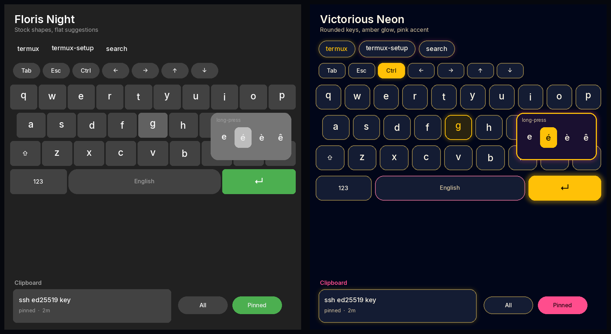 | 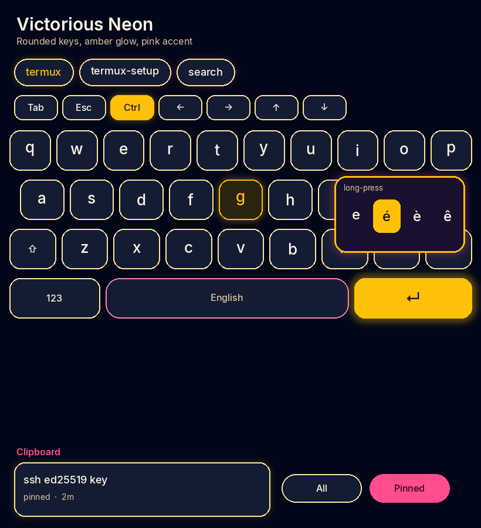 | 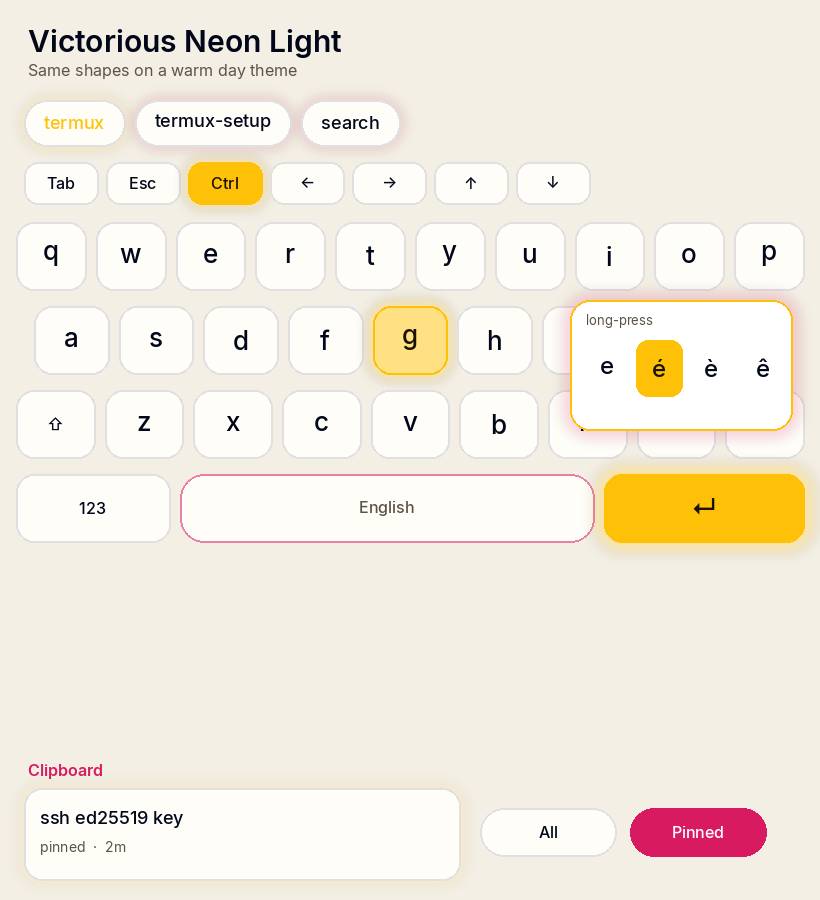 |

| Local AI settings | AI toolbar panel |
|---|---|
| 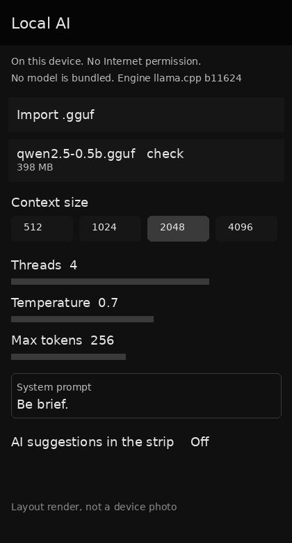 | 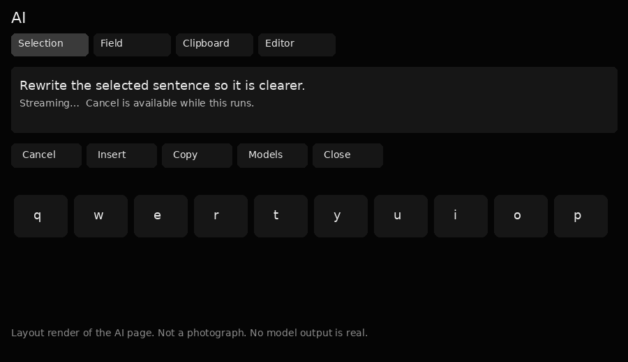 |

| Suggestion strip |
|---|
| 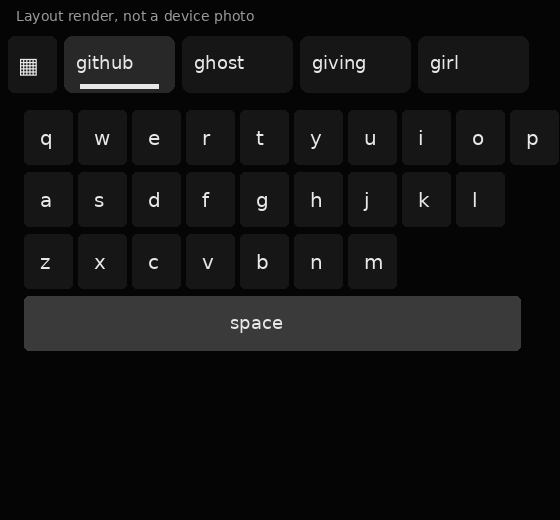 |

| My suggestions | Slash commands |
|---|---|
| 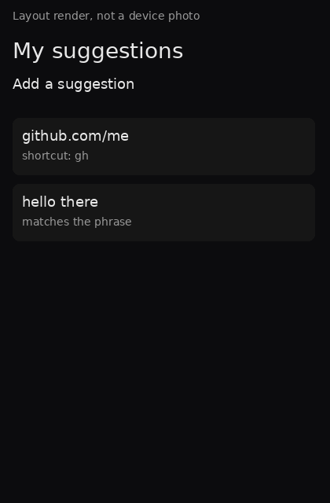 | 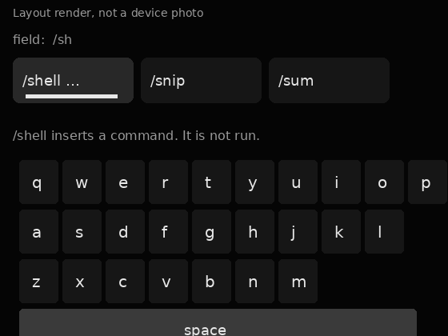 |

The strip, suggestions, and slash pictures are layout renders. They are not photographs of a device. There is no picture of the tabbed tools panel yet: it has not been rendered anywhere, and the earlier layout render showed the previous single-list panel, so it was removed.

These two Local AI pictures are layout renders of the screen structure. They are not photographs of a device.

| Settings, before and after | Keyboard colors | Color wheel |
|---|---|---|
| 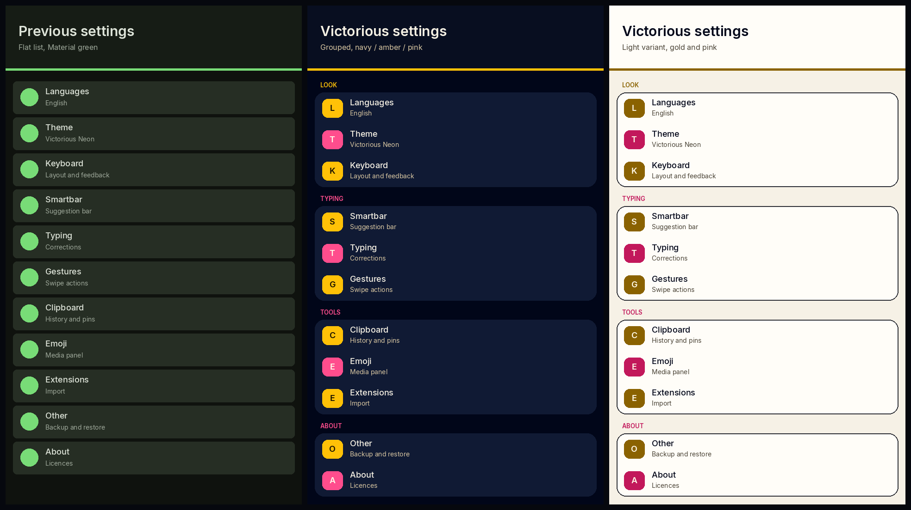 | 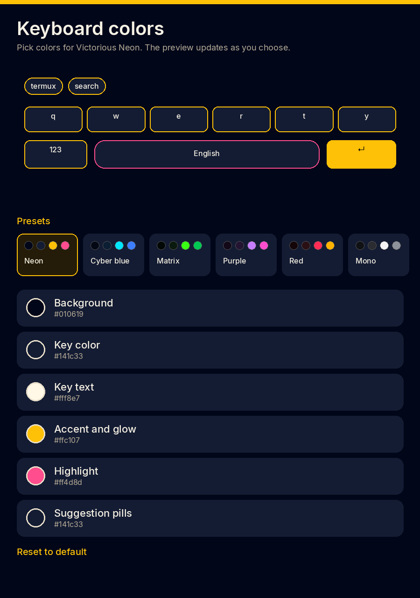 | 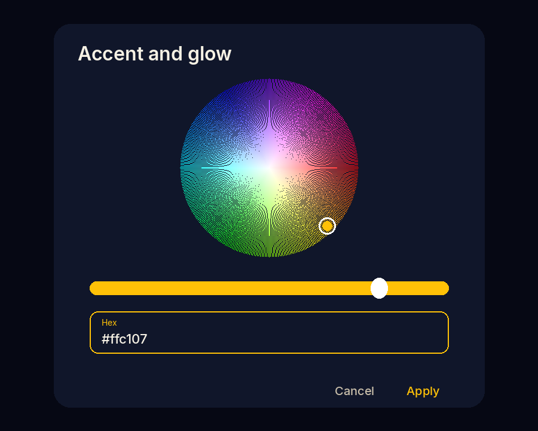 |

| Cyber blue | Matrix | Purple |
|---|---|---|
| 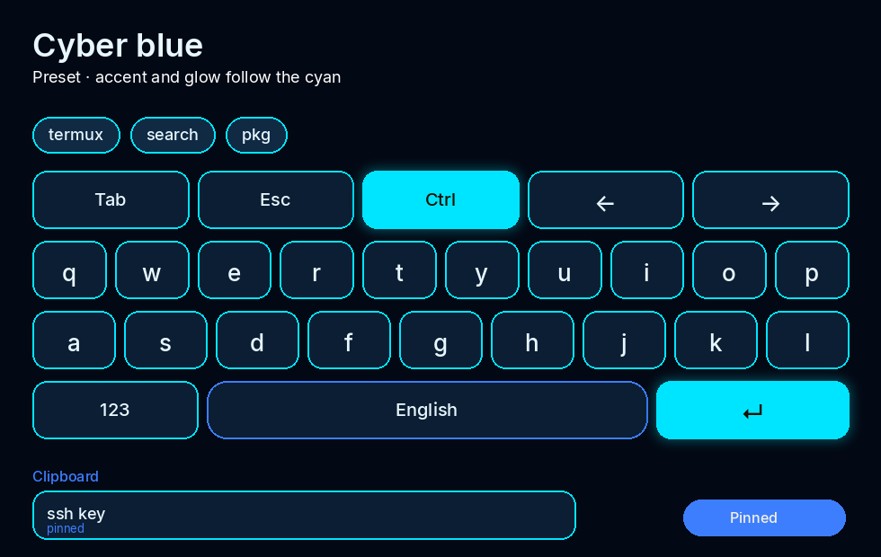 | 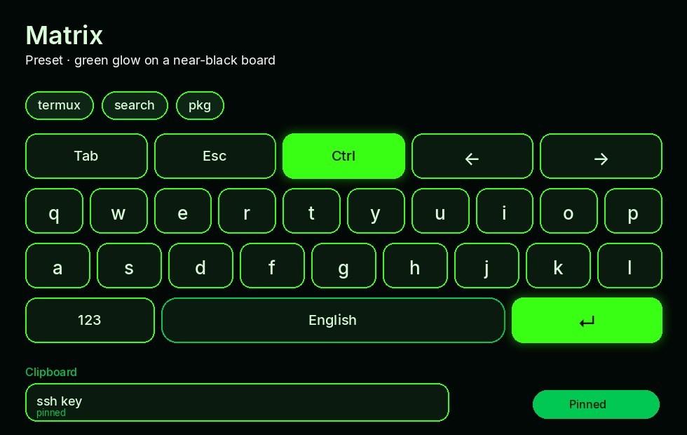 | 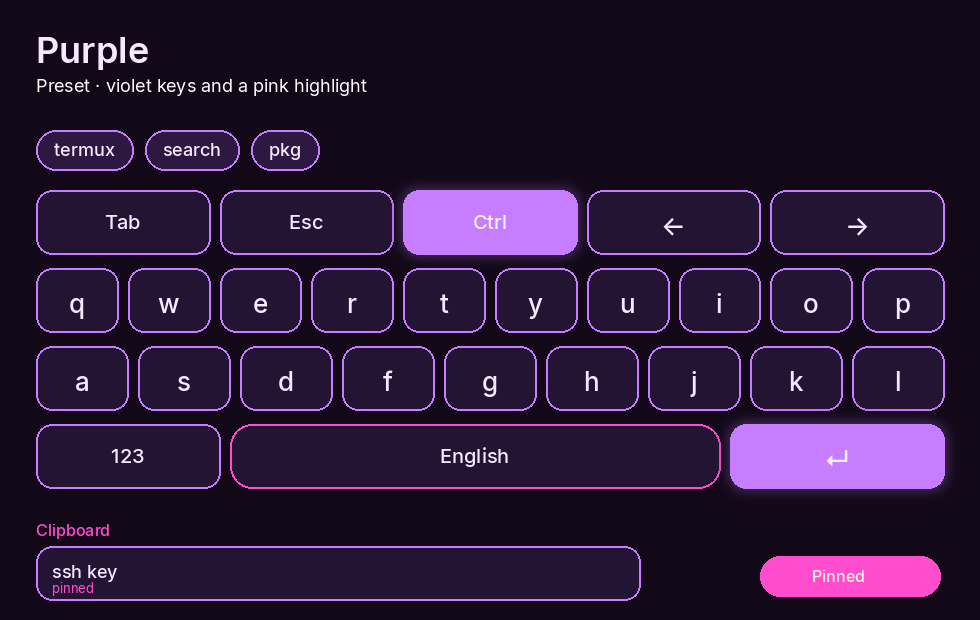 |

| Clipboard tab | Vault tab |
|---|---|
| 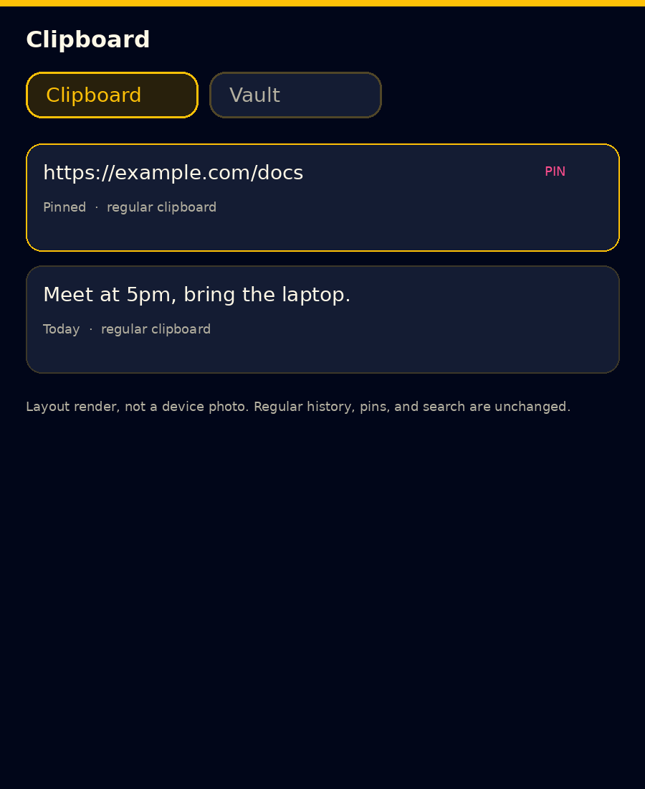 | 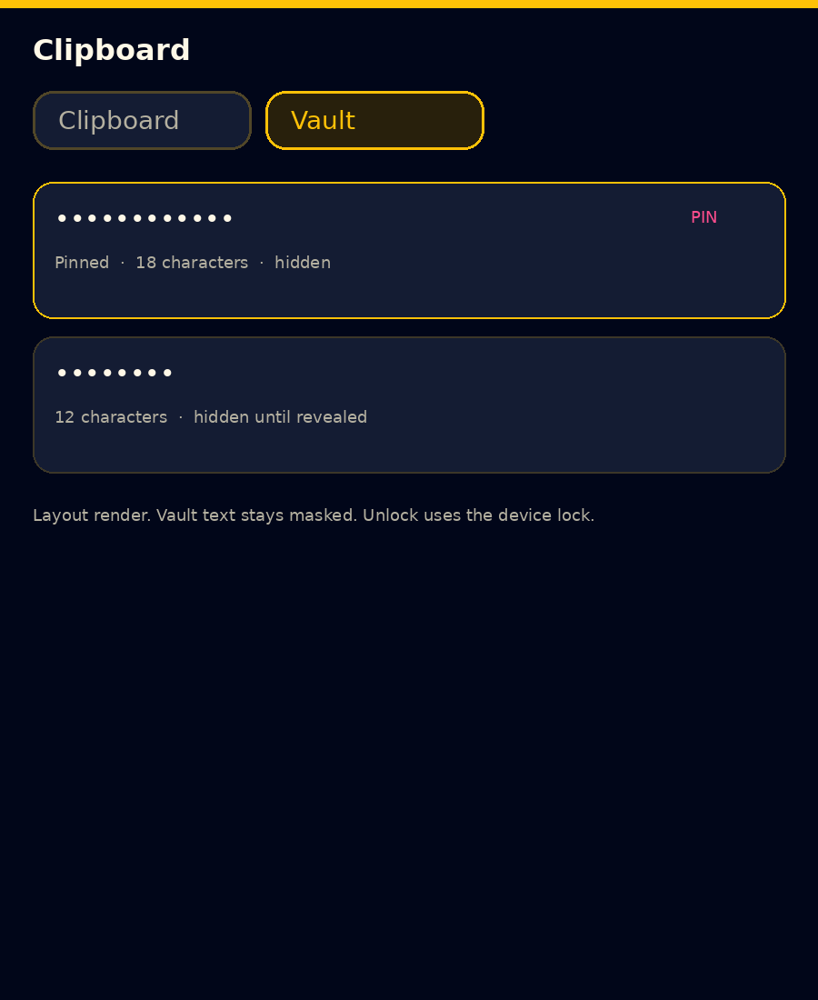 |

Still waiting on a device: the developer row with Ctrl locked, clipboard history with a pinned item, and the snippet picker.

## Status

| Phase | Scope | Status |
|---|---|---|
| 0 | Audit and baseline | ✅ |
| 1 | Project foundation, variants, CI | ✅ builds; unit tests pass |
| 2 | Stable keyboard engine | ⬜ needs a device |
| 3 | Advanced clipboard | 🟡 core tested; storage/UI compiled, not run |
| 4 | Developer and terminal modes | 🟡 core tested; wiring/row UI compiled, not run |
| 5 | Snippets and productivity | 🟡 core tested; Android shell compiled, not run |
| 6 | Word prediction | 🟡 predictor tested; suggestion wiring compiled, not run. Gesture typing not started |
| 7, 9–10 | AI workspace, security/perf, release | ⬜ |
| 8 | Themes | 🟡 Neon default and keyboard colors compiled, not run on a device; responsive layout not started |

Full detail: [ROADMAP.md](ROADMAP.md), [FEATURES.md](FEATURES.md).

## APK at a glance

| | |
|---|---|
| Application ID | `com.victorious.keyboard` (debug: `com.victorious.keyboard.debug`) |
| Version | `0.1.0-alpha01` (version code `120`) |
| Android | 8.0+ (`minSdk` 26); compile/target API 36 |
| Permissions | `VIBRATE`, `POST_NOTIFICATIONS` (setup flow) |
| Internet | **None** — no `INTERNET` permission |
| Analytics / ads / telemetry | None |
| Data | On-device only; clipboard, snippets, and learned words stay out of Android auto-backup |
| Distribution | Debug pre-release on GitHub Releases. Signed with the Android debug key, not a store build |

Privacy: [PRIVACY.md](PRIVACY.md).

## Requirements

* **JDK 21** (matches CI)
* Android SDK: `platforms;android-36`, `build-tools;35.0.0`
* Optional: connected device or emulator for sideload testing

## Download

The newest debug build is the latest pre-release on [GitHub Releases](https://github.com/Victorious93/Victorious-Keyboard/releases). It is signed with the Android debug key. It includes Victorious Neon, word prediction, keyboard colors, the separate sensitive clipboard, clipboard ZIP export and import, and the lift above the home-gesture strip. It has not been installed or exercised on a device from this repository. Install it with `adb install`, then enable Victorious Keyboard under Android *Language & input*.

## Build and install

Full steps and environment notes: [BUILD.md](BUILD.md).

```sh
git clone https://github.com/Victorious93/Victorious-Keyboard.git
cd Victorious-Keyboard
echo "sdk.dir=$ANDROID_HOME" > local.properties

./gradlew assembleDebug                          # app/build/outputs/apk/debug/app-debug.apk
./gradlew testDebugUnitTest :lib:kotlin:test     # JVM unit tests
```

Install with `adb install app/build/outputs/apk/debug/app-debug.apk`, then enable Victorious Keyboard under Android *Language & input* and select it as the active IME. Nothing in this repository has been installed or run on a device.

## Project structure

```text
app/                         Android application
  src/main/kotlin/dev/patrickgold/florisboard/
    FlorisImeService.kt      Input method service
    ime/clipboard/           Clipboard history, vault, backup/restore
    ime/developer/, terminal/ Developer row, key mapping, modifiers
    ime/mode/                Standard / Developer / Termux modes
    ime/snippets/            Templates, library, expansion, picker
    ime/dictionary/          Dictionaries and packs
lib/                         android, color, compose, kotlin, snygg
dictionary-packs/            Sources for the five bundled word lists
tools/, utils/               Pack builder and upstream utilities
docs/                        Branding, developer-keyboard notes, upstream docs
```

Kotlin package stays `dev.patrickgold.florisboard` to ease upstream merges; product identity is the application ID and resources. New features follow *pure-Kotlin core + thin Android shell* — see [ARCHITECTURE.md](ARCHITECTURE.md).

## Spell checker

The system spell-checker service is the Android one FlorisBoard exposes. Turn it on from the system keyboard settings after enabling Victorious Keyboard. Suggestions inside the keyboard are the on-device dictionary, not a network spell check.

## Theme editor

Settings → Theme → the extension list opens the theme editor shipped with the keyboard. Styles are Snygg stylesheets (`app/src/main/assets/ime/theme`). The default themes are Victorious Neon and Victorious Neon Light; older themes stay in the list.

## Documentation

| Document | Covers |
|---|---|
| [FEATURES.md](FEATURES.md) · [ROADMAP.md](ROADMAP.md) | Feature status and phases |
| [ARCHITECTURE.md](ARCHITECTURE.md) · [BUILD.md](BUILD.md) · [TESTING.md](TESTING.md) | Structure, build, tests |
| [CLIPBOARD.md](CLIPBOARD.md) · [SNIPPETS.md](SNIPPETS.md) · [DICTIONARY_PACKS.md](DICTIONARY_PACKS.md) · [TERMINAL.md](TERMINAL.md) | Feature design docs |
| [PRIVACY.md](PRIVACY.md) · [SECURITY.md](SECURITY.md) | Data handling and vulnerability reports |
| [CONTRIBUTING.md](CONTRIBUTING.md) · [CODE_OF_CONDUCT.md](CODE_OF_CONDUCT.md) | Contribution rules |
| [LICENSES.md](LICENSES.md) · [docs/upstream/](docs/upstream/) | Licences and upstream attribution |

## Contributing

Issues and pull requests are welcome. Correctness and honesty about what was tested matter more than speed. Read [CONTRIBUTING.md](CONTRIBUTING.md) first:

* One logical change per PR; keep `./gradlew assembleDebug testDebugUnitTest` green.
* Put logic in pure Kotlin and unit-test it, including failure paths.
* Never log or transmit typed text, clipboard contents, or snippets.
* State in the PR what you tested and what you could not (e.g. no device).

Follow the [Code of Conduct](CODE_OF_CONDUCT.md). Report vulnerabilities via [SECURITY.md](SECURITY.md).

## Licence

Licensed under the [Apache License 2.0](LICENSE); see also [LICENSES.md](LICENSES.md). Upstream copyright notices are preserved; the About screen credits FlorisBoard.

## Acknowledgements

* **[FlorisBoard](https://github.com/florisboard/florisboard)** by Patrick Goldinger and The FlorisBoard Contributors (Apache-2.0), base `v0.6.0-alpha02` (commit `0ea0481c`). Typing engine, layouts, themes, Snygg, and settings framework are theirs.
* Libraries listed in [LICENSES.md](LICENSES.md) and the in-app About screen (AndroidX, Compose, Kotlin, kotest, JetPref, and others).
